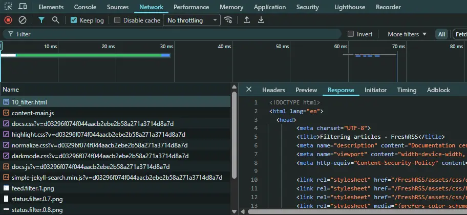

I'm a fan of the Wordle puzzle. It's not my *favorite* New York Times puzzle.. I think that'd be Strands. But it's the one that's gotten the most publicity, and the one that our family likes to do and share in a group chat every day.

Getting the Wordle in 3 guesses is solid. 2 guesses takes more luck, but still earns you bragging rights. But *one* guess??? That's only happened once, and I'll tell ya, it raises some eyebrows. Fortunately, now I can "guess" the answer in one try, every day, and be the Wordle champ for all time.

## Client-side retrieval

Awhile back, I was doing a Strands puzzle and noticed that even though my phone had no cell service, I could keep making guesses and even solve it. That's the one where you can find *any* word with 4+ letters to earn hints to help find the theme words.

Up till then, I'd just assumed (without thinking about it) that the website was making a tiny API call on every guess. In retrospect, all those calls from tens of millions of users between all the different puzzles would be insane. It'd make much more sense to download everything beforehand and let the magic happen client-side, so I opened the [dev console](/how-do-i-view-the-dev-console-in-my-browser) and started poking around.

For the uninitiated, you can switch over to the "Network" tab in any browser, refresh the page, and see every call a website makes to get what it needs. It'll start with the HTML file to get the [DOM](https://developer.mozilla.org/en-US/docs/Web/API/Document_Object_Model), which tells it everything else to get - CSS files, images, JavaScript, etc. And then if those styles and scripts need things like favicons, fonts, JSON files, etc., you can see those all being retrieved too.



## Client-side JSON

A quick scan down the list showed all the assets being downloaded, including a call to get a JSON file like [this one](https://www.nytimes.com/svc/strands/v2/2026-10-27.json). It's got everything the app needs to work offline.. the initial clue, all 1000+ possible words, the 6 theme words and the spangram, etc. It's too large to paste in here, but everything's there, going back to the beginning.

So I checked the Wordle and [found one there](https://www.nytimes.com/svc/wordle/v2/2026-10-28.json) too. It's *tiny*, like a hundred bytes. That's all it needs. I didn't try digging up and unwinding the client-side code that's running (it's probably obfuscated anyway), but it's easy to imagine how it'd take the letters you entered, compare it to the "solution" below, and then color a box green or yellow.

```json
{
  "id": 4821,
  "solution": "grist",
  "print_date": "2026-10-28",
  "days_since_launch": 1957,
  "editor": "Tracy Bennett"
}
```

## One-shot Wordles

There ya go. Just change the date on the end of the URL to today's, and you can easily get it in one try every day, LOL. Obviously no one who enjoys doing the puzzle would do this, and anyone trying to gaslight their friends or keep their streak alive at a minute to midnight can just visit a site like [this one](https://wordle.today/answers). But those sites only tell you what is and what was.. what about predicting the future?

I'm not sure why, but they generate the JSON files for these puzzles *way* ahead of time. Maybe so they can be reviewed, approved, and ready to go? But there's no need to make the files publicly available before the day they're needed.. 🤔

Whatever the reason, you can change the date on the URL and set it out weeks into the future. When I first noticed this, Wordles went out to 12/9/2026, which was 6 weeks away. A day later, the latest available date jumped to 12/17/2026.

So the next time a friend visits from out of town, who's into the Wordle, write next month's answer on a piece of paper and slip it in their luggage. A few weeks after they get back, have them check what you wrote down to see how well you predicted the future. 🔮